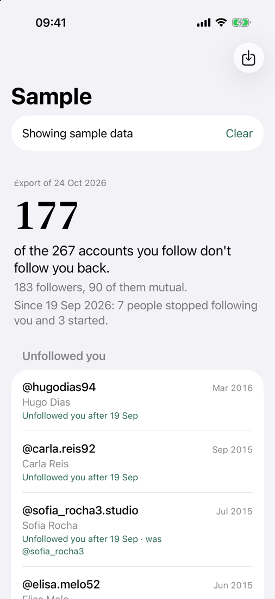
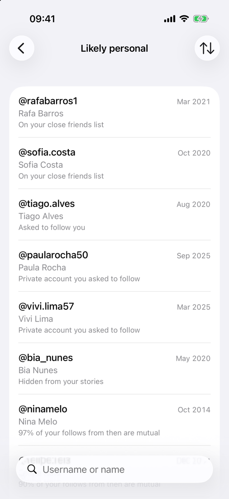

# Mutuals

[](https://github.com/ayanliger/mutuals/actions/workflows/tests.yml)
[](LICENSE)
[](https://developer.apple.com/ios/)
[](https://www.swift.org)
[](https://developer.apple.com/xcode/swiftui/)
[](https://developer.apple.com/xcode/)
[](MutualsCore/Package.swift)

An iPhone app that lists the Instagram accounts you follow that don't follow you back, with the people who used to follow you at the top. It works from the data export Instagram gives you, so there is no login, no ads and no network access.

<p>
  
  
</p>

## How it works

Instagram doesn't say who unfollowed you, but its data export contains your followers and following lists with the date each follow started. Mutuals keeps every export you import and compares each one with the ones before it. An account that followed you in an earlier export, doesn't follow you in the latest one, and that you still follow goes under Unfollowed you. Accounts that changed username are matched by account id or follow date.

The first export has no history to compare against, so the app looks for other signs that an account belongs to a person rather than a creator: your close friends list, follow requests, stories you hide from them, and when you followed them. If most of the accounts you followed in the same period follow you back, the ones that don't are likely people you know.

The app never unfollows anyone. Tapping an account opens its profile in Instagram, and when you come back the app asks whether you unfollowed. The next export confirms it.

## Getting the export

1. In Instagram, go to Accounts Center > Your information and permissions > Export your information.
2. Tap Create export, choose your Instagram account, then Export to device.
3. Under Customize information, select only Followers and following.
4. Set the date range to All time and the format to JSON.
5. When Instagram notifies you, download the zip and import it in Mutuals, or share it to the app from Files.

Importing a new export every week or two builds the history. Older exports can be imported too; the app sorts them by date. HTML exports are read as well, but they have no follow dates, so renames and follow periods can't be detected from them.

## Building

You need Xcode 26 or later. The app runs on iOS 18 and later.

1. Copy `Config/Local.xcconfig.example` to `Config/Local.xcconfig` and set your team ID and a bundle ID prefix.
2. Open `Mutuals.xcodeproj`, select your iPhone and run.

With a free Apple developer account the installed app expires after 7 days. Running it from Xcode again renews it and keeps your data.

Export parsing and the comparisons live in the `MutualsCore` Swift package, which has its own tests. CI runs them on every push:

```sh
swift test --package-path MutualsCore
```

Debug builds accept launch arguments for working in the simulator: `-sample` loads demo data, `-import <path>` imports a file at launch, and `-route <screen>` opens a screen (`unfollowed`, `personal`, `rest`, `kept`, `requests`, `history`, `snapshot` or `about`).

## Limitations

Instagram changes the export format now and then. The August 2026 change put usernames under labels written in the account's language ("Nome de usuário" in Portuguese), so the parser finds the username field by the shape of its values instead of its label. If an import fails, open an issue describing the file's structure, without your data.

The follow-period signal is a heuristic. Celebrities you followed in the same months as your friends can show up under Likely personal; swipe right on them to keep them out of the lists.

## License

MIT
